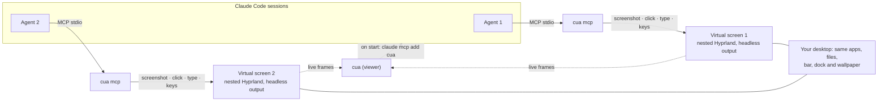

<p align="center">
  
</p>

<h1 align="center">cua</h1>

Computer use for Claude Code on Linux with Hyprland: every Claude Code session gets its own virtual screen on your computer, with the same apps, files, wallpaper, bar and dock. Agents work in parallel without touching your mouse, your keyboard or each other.

> **Limitation:** cua currently works only on Hyprland, because each agent's screen is a copy of your own desktop; other desktops (GNOME, KDE, sway, X11…) each need their own backend, and contributions adding them are very welcome.

## Build and run

Needs Rust, and Hyprland installed and running as your Wayland compositor (each agent's screen is a nested Hyprland instance).

```sh
cargo build --release
./target/release/cua
```

On start, `cua` adds itself to your app launcher (`~/.local/share/applications/cua.desktop`) and registers itself with Claude Code as the `cua` MCP server (run `/mcp` in sessions that were already open). Ask Claude Code to do something on the computer. Each agent shows up on the left; click one to watch its screen live.

## How it works


